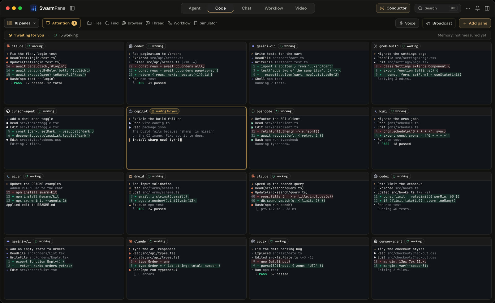

  

<h1 align="center">SwarmPane</h1>

  <b>Every AI coding agent. One window.</b> 
  Run Claude Code, Codex, Gemini CLI, Cursor, Copilot, Devin and more side by side, up to 16 at once, in real terminals on your computer.

  <a href="https://swarmpane.com/downloads?utm_source=github&utm_medium=readme"><b>Download</b></a> ·
  <a href="https://swarmpane.com/pricing?utm_source=github&utm_medium=readme">Pricing</a> ·
  <a href="https://swarmpane.com/docs?utm_source=github&utm_medium=readme">Docs</a> ·
  <a href="https://www.youtube.com/watch?v=gUkCgPUHOOI">10-minute tour</a> ·
  <a href="https://swarmpane.com/changelog?utm_source=github&utm_medium=readme">Changelog</a>

  

## What it does

- **Up to 16 agents in one window.** Claude Code, Codex, Gemini CLI, Antigravity CLI, Cursor Agent, GitHub Copilot, Grok Build, OpenCode, Devin, Hermes Agent, Kimi CLI, Aider and Droid, each in a real terminal pane next to your project files, Git and a browser preview.
- **See which one needs you.** The pane waiting for an answer or an approval lights up, so you never miss a "Do you want to proceed?".
- **Each agent gets its own copy.** Give an agent its own Git worktree, so parallel work doesn't collide.
- **Undo any agent step.** A checkpoint before every step that can edit your files, and a one-click rewind of that step.
- **Hit a limit? Switch accounts.** Keep work and personal Claude Code or Codex sign-ins side by side, and carry the work to another account or agent.
- **Workflows.** Chain up to 16 steps: each result passes to the next agent, and approval steps pause the run.
- **Web access** (Labs). Every agent can search the web and read pages.
- **SwarmPane Voice** (Pro, Mac). Press ⌘⇧Space and talk: your words land as a draft in the pane.

## Uses the subscriptions you already have

SwarmPane runs the coding CLIs installed on your computer, signed in with your own accounts: Claude Pro or Max, ChatGPT, API keys. Each CLI talks to its own provider directly, and your projects and conversations stay on your computer. There's no extra AI bill from us.

## Get it

| | |
|---|---|
| **Mac** | macOS 13 or later, Apple silicon and Intel |
| **Windows** | Windows 10 or 11, x64 |
| **Linux** | x64: Ubuntu 22.04, Debian 12, Fedora 36 or later |

The app runs with a plan: **Starter** $17/month, **Pro** $29/month (adds Voice and Video Studio) or **Ultra** $50/month. Every plan starts with a **7-day trial for $1**, and making an account is free.

→ [Pricing](https://swarmpane.com/pricing?utm_source=github&utm_medium=readme) · [Downloads](https://swarmpane.com/downloads?utm_source=github&utm_medium=readme)

## Watch the tour

More on the [SwarmPane YouTube channel](https://www.youtube.com/@swarmpane) and on [Product Hunt](https://www.producthunt.com/products/swarmpane).

## About this repository

The SwarmPane app is closed source. This repository is where you can:

- [report a bug](../../issues/new?template=bug_report.yml)
- [ask for a feature](../../issues/new?template=feature_request.yml)
- see what shipped, in the [changelog](https://swarmpane.com/changelog?utm_source=github&utm_medium=readme)

SwarmPane is built in public by one founder, Borhen. A question about your account or billing? Email [support@swarmpane.com](mailto:support@swarmpane.com): it comes straight to me.

Claude and Claude Code are products of Anthropic; ChatGPT and Codex of OpenAI; Gemini and Antigravity of Google. SwarmPane is independent and isn't run or endorsed by them.
